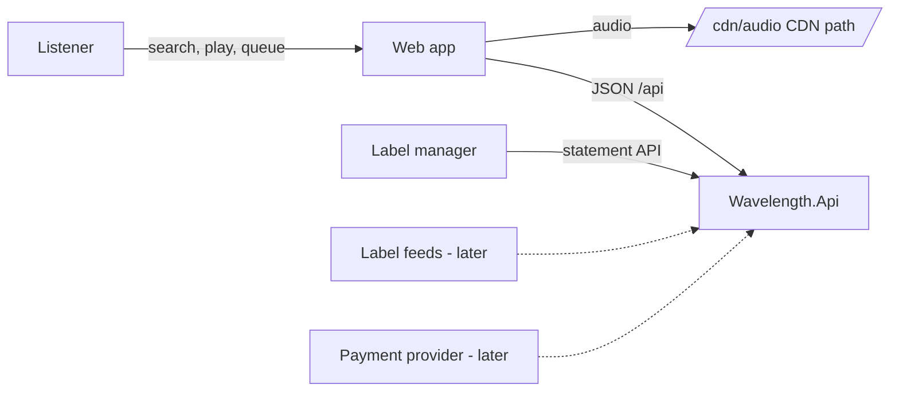

# Architecture

## Style and why
Advisor output (traits: MediaDelivery, ReadHeavy, PersonalData, MoneyMovement, SeveralBusinessAreas, ExternalPartnerIntegrations, SmallTeam):

### Recommendation: ModularMonolith

Several business areas need clear boundaries, but one deployment and one database keep it cheap to run and easy to hand over.

#### Patterns
- **AppendOnlyLedger**: Record debits and credits as new entries instead of overwriting a balance, so money always balances and can be traced.
- **IdempotencyKeys**: Every money-moving request carries a key, so a retry can never pay twice.
- **TransactionalOutbox**: Save the change and the event in one transaction, so other parts never miss a payment.
- **CachedReadModel**: Serve searches from a separate, cached read side so reads never slow down writes.
- **Cdn**: Large files go through a CDN, never through your application servers.
- **AdapterPerPartner**: Each outside system gets its own adapter behind an interface, so its quirks stay out of your domain.
- **PersonalDataProtection**: Collect the minimum, encrypt it, log who read it, and be able to delete it (POPIA/GDPR).

#### Closest reference systems
- E-commerce shop (similarity 0.50): Modular monolith with a separate catalogue read model (document store, cache, CDN); extract search as a service when traffic grows.
- Hotel or airline booking (similarity 0.50): Modular monolith with a separate cached search side; microservices at global scale.
- Photo-sharing social feed (similarity 0.50): At global scale: media, graph, feed and notification services, a CDN for images, and feeds pre-built per follower (fan-out on write) with a pull fallback for very popular accounts.

#### Risks to watch
- Modules decay into a big ball of mud unless boundaries are enforced by tests (no cross-module database access).
- Floating-point money or update-in-place balances. Use decimal and ledger entries only.

#### Evolve when
- One module needs to scale or deploy on a different schedule: extract only that module as a service.
- Separate teams own separate modules and block each other's releases.
- Search becomes the bottleneck: move it to a dedicated search service.

Record the final choice with write_adr, including what you rejected.

Judgement: Launch as a modular monolith (Catalogue, Playback, Playlists, Royalties) with audio behind a CDN, play events written idempotently, and royalties calculated from an append-only play ledger.

At global scale the advisor's answer is **Microservices**. Evolution trigger: Move play-event ingestion into a separate pipeline when events pass ~5,000/second; extract Search as a cached read service when it needs its own scaling (reference #5).
See `decisions/0001-architecture-style.md`.

## Context

Full C4, sequences, data model and scaling path: `docs/DESIGN.md`.

## Modules and boundaries
| Module (project) | Owns | Exposes | May call |
|---|---|---|---|
| Catalogue (`src/Modules/Catalogue`) | labels, artists, albums, tracks; `SearchIndex` read model (normalised, accent-insensitive, prefix) | `/api/search`, `/api/tracks/{id}`, `/api/artists/{id}`, `/api/albums/{id}`, `/api/labels`; implements `ICatalogueDirectory` | nothing |
| Playback (`src/Modules/Playback`) | play sessions keyed by client play ID; the 30 s rule | `POST /api/plays`; publishes `TrackPlayQualified` once per play ID | `ICatalogueDirectory` |
| Playlists (`src/Modules/Playlists`, minimal) | read-only curated playlists | `/api/playlists`, `/api/playlists/{id}` | `ICatalogueDirectory` |
| Royalties (`src/Modules/Royalties`) | append-only `RoyaltyLedger` (unique play ID), statements with reconciliation | `/api/labels/{id}/statement`, `/api/labels/{id}/ledger`; consumes `TrackPlayQualified` | `ICatalogueDirectory` |

- Cross-module contracts live only in `src/Wavelength.SharedKernel` (`ICatalogueDirectory`, `TrackRef`, `LabelRef`, `TrackPlayQualified`, `IIntegrationEventPublisher`, `IIntegrationEventConsumer<T>`, `Money`).
- A module's public types are its `<Module>Module` entry class and its `Contracts` namespace; everything else is `internal`. Enforced by `tests/Wavelength.Tests/Architecture/ModuleBoundaryTests.cs`.
- `src/Wavelength.Api` is the composition root: DI, ProblemDetails, health checks, `InProcessEventPublisher`, CDN static files (`wwwroot/cdn`, immutable cache).

## Cross-cutting
- **Errors:** RFC 9457 ProblemDetails (`AddProblemDetails`, `UseExceptionHandler`, `UseStatusCodePages`); validation errors as `ValidationProblem` with field names.
- **Time:** `TimeProvider` injected everywhere (tests use a manual clock). Statement periods are whole UTC days, inclusive.
- **Money:** `decimal` in `Money(Amount, Currency)`; rate from config `Royalties:RatePerPlay` (default 0.05 ZAR), validated on start.
- **Idempotency:** client play ID (UUID) per listen; unique in Playback sessions and in the ledger.
- **Events:** in-process, synchronous in slice 1 (failure reverts and the client retries); transactional outbox in slice 2.
- **Persistence:** thread-safe in-memory stores behind module-internal types; Postgres in slice 2.
- **Health:** `/health/live` (process up), `/health/ready` (catalogue index + ledger checks).
- **Auth, tracing:** not in slice 1; OIDC and OpenTelemetry are backlog items.
