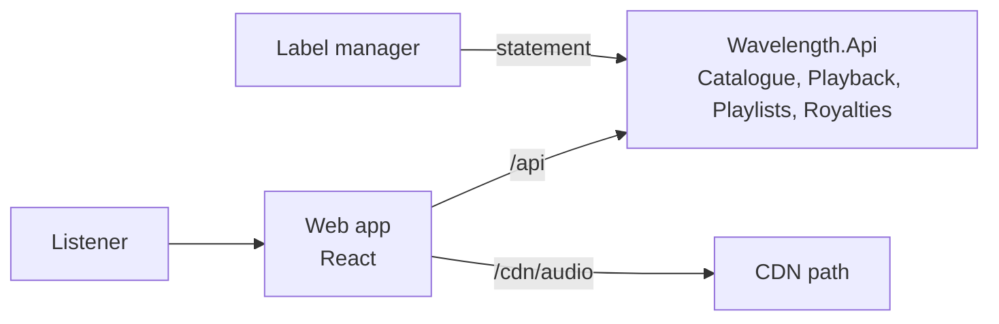

# Wavelength

## Design at a glance
An original music streaming service for Mzansi Indie Alliance (fictional), a collective of 300 independent South African labels. Listeners search and play; labels get every qualifying play counted once and paid from a ledger that reconciles to the cent.

**Architecture:** a modular monolith (Catalogue, Playback, Playlists, Royalties) with a separate in-memory search read model, audio on a CDN path, idempotent play events keyed by a client play ID, and an append-only royalty ledger. It suits four engineers and ~110 events/s at peak; module boundaries are enforced by tests so Search or play ingestion can be extracted when the ADR-0001 trigger (~5,000 events/s) is hit. Full reasoning, options table and diagrams: [`docs/DESIGN.md`](docs/DESIGN.md).




## Run it in GitHub Codespaces

[](https://codespaces.new/Legion91919/wavelength?quickstart=1)

The dev container installs the SDKs, restores packages and runs every test once on first start. The same setup works locally with VS Code's Dev Containers extension.

| What | Command | Port |
|---|---|---|
| API (Wavelength) | `ASPNETCORE_ENVIRONMENT=Development ASPNETCORE_URLS=http://0.0.0.0:5105 dotnet run --project src/Wavelength.Api` | 5105 |
| Web app | `cd web && npm run dev` | 5205 |
| All tests (same as CI) | `scripts/test-all.sh` | - |

## What it does (slice 1)
- Search tracks, artists and albums; accents and case optional ("meridien" finds "Méridien").
- Play a track in the browser (HTML audio element), add tracks with **+ Next**, manage the queue.
- The player reports each listen with a client-generated play ID at 30 listened seconds and at the end. A play counts for the label once it reaches 30 seconds, and only once per play ID.
- `GET /api/labels/{id}/statement?from=&to=` sums qualifying plays per track and proves it matches the ledger.
- All data and audio are invented (generated tones, fictional labels and artists).

## Run locally
```bash
ASPNETCORE_ENVIRONMENT=Development ASPNETCORE_URLS=http://localhost:5105 dotnet run --project src/Wavelength.Api
cd web && npm ci && npm run dev   # http://localhost:5205
```
Tests and details: `.agentic/runbook.md`.

## How this project is organised
`src/Wavelength.Api` (composition root), `src/Modules/*` (one project per module), `src/Wavelength.SharedKernel` (cross-module contracts), `tests/Wavelength.Tests`, `web/` (React + Vite). Project knowledge lives in the hidden `.agentic/` folder (start with `.agentic/README.md`). AI agents read `AGENTS.md` first.

Built with the Baton model from the Agentic Engineering Kit: frame → map → decide → sketch → slice loop → pass the baton.
