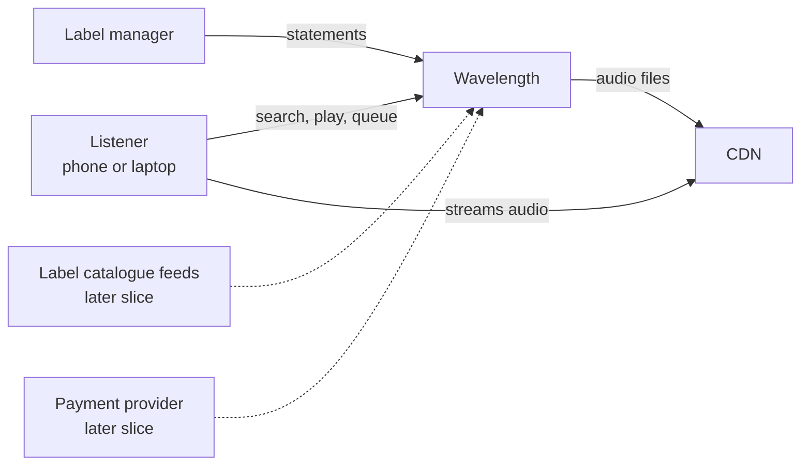
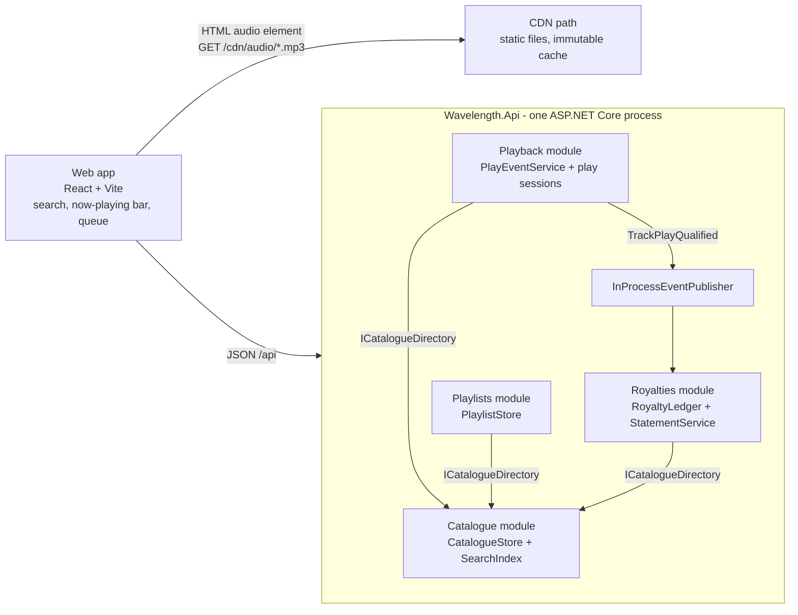
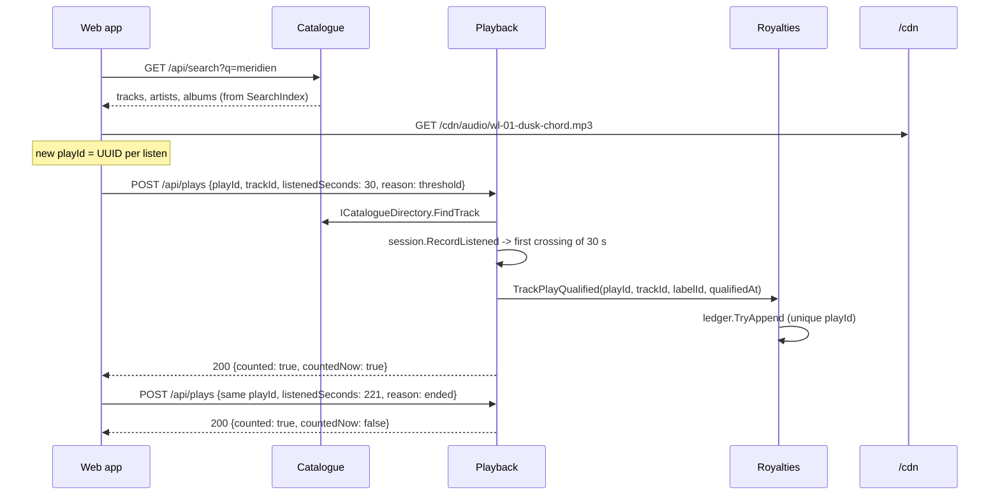
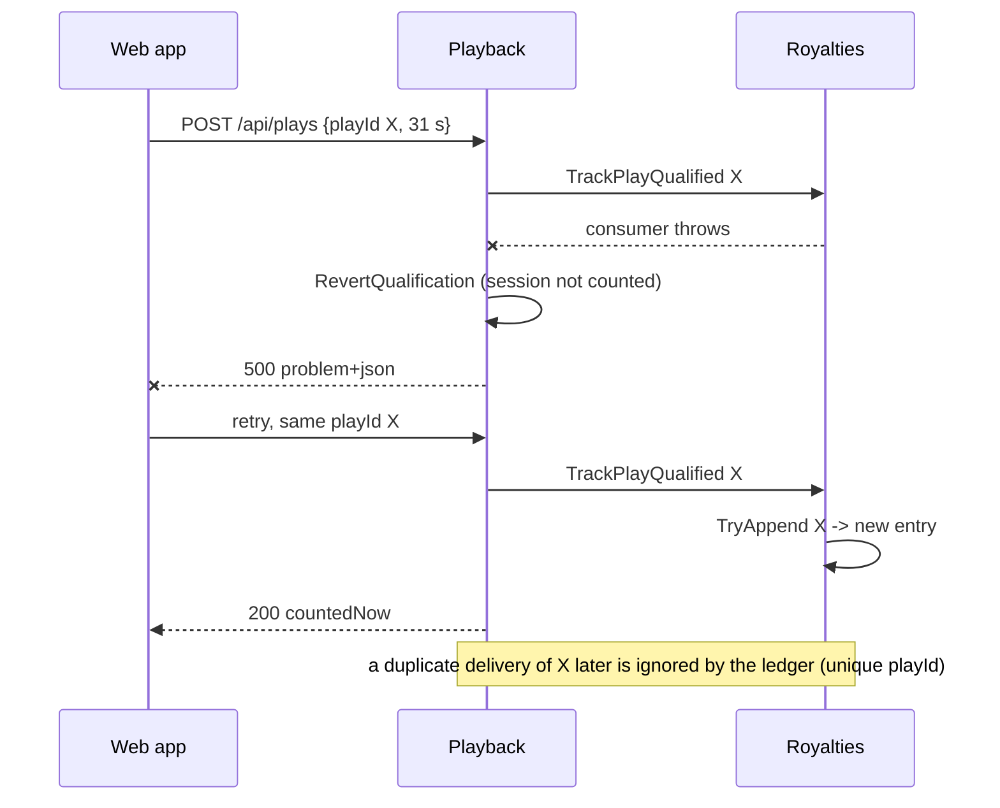
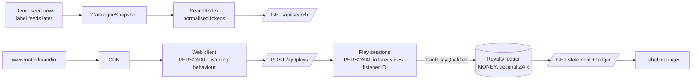
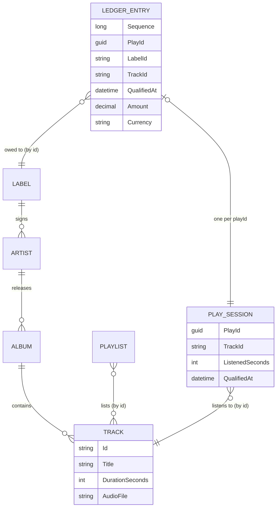

# Wavelength: design dossier

A 15-minute read: what was built, why this way, and what changes at 100x. Every diagram matches the code in `src/` (slice 1).

## 1. Brief
- **Client:** Mzansi Indie Alliance (fictional), a collective of 300 independent South African labels. All names and numbers are invented.
- **Problem:** independent labels earn little from global platforms and get no clear numbers on who listens, so they can't pay artists fairly or plan tours.
- **Users:** listeners (daily, mobile, commuting); label managers (monthly royalty statements).
- **Outcomes:** search results in under 300 ms; next track starts without a gap; every qualifying play counted once for royalties.

## 2. Requirements
**Functional (slice 1, done):**
- Search tracks, artists and albums; accent- and case-insensitive, prefix matching (`GET /api/search`).
- Play a track, queue the next (client queue; tracks streamed from `/cdn/audio/...`).
- Client reports plays with a client-generated play ID (`POST /api/plays`) at 30 s and at the end.
- A play counts for royalties at 30 listened seconds, once per play ID, into an append-only ledger per label.
- Label statement for a period (`GET /api/labels/{id}/statement`) reconciles exactly with the ledger (`GET /api/labels/{id}/ledger`).

**Non-functional:**

| Concern | Target | Source |
|---|---|---|
| Search latency | p95 < 300 ms at the API | product outcome |
| API availability | 99.9 % / 30 days | `quality.md` |
| Royalty accuracy | 0 double counts; statement = ledger to the cent | product constraint |
| Play event durability | no accepted qualifying play lost (slice 2: Postgres + outbox) | ADR-0001 |
| Retention | ledger kept 7 years (tax records); listening history 13 months, then aggregated | assumption |
| Privacy | POPIA: minimum personal data, deletable listener history | product traits |

## 3. Capacity estimate
Assumptions (rounded up): 200k monthly listeners, 60k daily; 20 plays per listener per day; 4x peak in commute hours; 70 % of plays pass 30 s; 300 labels x 1,000 tracks.

| Quantity | Sum | Result |
|---|---|---|
| Plays per day | 60k x 20 | 1.2 M |
| Play events per second, peak | 1.2 M x 2 reports / 86,400 s x 4 | ~110 /s |
| Searches per second, peak | 60k x 10 / 86,400 x 4 | ~30 /s |
| Ledger growth | 1.2 M x 0.7 x ~150 B | ~125 MB/day, ~46 GB/year |
| Search index in memory | 300k tracks + artists + albums x ~300 B | ~100 MB |
| Audio egress | 1.2 M x ~2.5 MB (128 kbps, partial plays) | ~3 TB/day, ~1.1 Gbps peak: CDN only |

One modest server handles the API load with large headroom; the bandwidth is the reason audio must never pass through the API. The evolution trigger (5,000 events/s) is ~45x this peak.

## 4. Options considered
`arch-advisor compare` with the launch traits (MediaDelivery, ReadHeavy, PersonalData, MoneyMovement, SeveralBusinessAreas, ExternalPartnerIntegrations, SmallTeam):

| Option | Fit | Complexity (1-5) | Main reason |
|---|---|---|---|
| Modular monolith + CQRS read models | Recommended | 3 | Matches the advisor's recommended style (ModularMonolith). |
| Modular monolith | Good alternative | 3 | Same family as the recommendation; a valid variant if its trade-offs suit the team. |
| Event-sourced core with CQRS | Good alternative | 4 | Same family as the recommendation; a valid variant if its trade-offs suit the team. |
| Static site + serverless function | Poor fit | 1 | The product has real server-side behaviour and data; a static site can't hold it. |
| Layered monolith | Poor fit | 1 | Several business areas would tangle without module boundaries. |
| Vertical slice monolith | Poor fit | 2 | Several business areas would tangle without module boundaries. |
| Clean Architecture monolith | Poor fit | 2 | Several business areas would tangle without module boundaries. |
| Serverless functions + queues | Poor fit | 3 | Consistency-critical money or stock operations are awkward across stateless functions. |
| Microservices (request/response) | Poor fit | 5 | A small team can't run a distributed system well (deployments, tracing, on-call). |
| Event-driven microservices | Poor fit | 5 | A small team can't run a distributed system well (deployments, tracing, on-call). |

With the global-scale traits (MediaDelivery, ReadHeavy, GlobalScale, PersonalData, MoneyMovement):

| Option | Fit | Complexity (1-5) | Main reason |
|---|---|---|---|
| Microservices (request/response) | Recommended | 5 | Matches the advisor's recommended style (Microservices). |
| Event-driven microservices | Good alternative | 5 | Same family as the recommendation. |
| Modular monolith | Possible | 3 | Money: pair it with an append-only ledger and idempotency keys. |
| Modular monolith + CQRS read models | Possible | 3 | Money: pair it with an append-only ledger and idempotency keys. |
| Event-sourced core with CQRS | Possible | 4 | Money: pair it with an append-only ledger and idempotency keys. |
| Static site + serverless function | Poor fit | 1 | The product has real server-side behaviour and data. |
| Layered / vertical slice / Clean monolith | Poor fit | 1-2 | Can't scale the hot part independently, and has no seams to extract it later. |
| Serverless functions + queues | Poor fit | 3 | Consistency-critical money operations are awkward across stateless functions. |

- **Chosen: modular monolith + CQRS read model.** Four business areas (Catalogue, Playback, Playlists, Royalties) with clear seams, one deployable for four engineers. Search is served from a separate in-memory read model (`SearchIndex`), money from an append-only ledger.
- **Plain modular monolith:** what we have minus the read model; search over the write model would couple query speed to catalogue writes. Lost narrowly.
- **Event-sourced core:** full replay is attractive for royalties, but the ledger already gives an auditable history at a fraction of the learning cost. Revisit if auditors want point-in-time replay of the catalogue too.
- **Microservices / event-driven:** the global-scale answer. Too heavy for four engineers and ~110 events/s. Module boundaries match future services, so extraction is a deployment change.
- **Serverless:** play counting needs strict once-only semantics per play ID; stateless functions make that harder, not easier.
- **Evolution trigger (ADR-0001):** move play-event ingestion into a separate pipeline when events pass ~5,000/s; extract Search as a cached read service when it needs its own scaling.

## 5. Architecture
**C4 context**

**C4 containers (slice 1)**

| Module | Owns | Public surface | May call |
|---|---|---|---|
| Catalogue | labels, artists, albums, tracks, search read model | `/api/search`, `/api/tracks/{id}`, `/api/artists/{id}`, `/api/albums/{id}`, `/api/labels`; implements `ICatalogueDirectory` | nothing |
| Playback | play sessions (play ID, listened seconds, qualified at) | `POST /api/plays`; publishes `TrackPlayQualified` | `ICatalogueDirectory` |
| Playlists (minimal) | curated lists of track IDs | `/api/playlists`, `/api/playlists/{id}` | `ICatalogueDirectory` |
| Royalties | append-only ledger, statements | `/api/labels/{id}/statement`, `/api/labels/{id}/ledger`; consumes `TrackPlayQualified` | `ICatalogueDirectory` |

Contracts live in `Wavelength.SharedKernel` (`ICatalogueDirectory`, `TrackRef`, `LabelRef`, `TrackPlayQualified`, `Money`). No module references another module; everything else in a module is `internal`. `ModuleBoundaryTests` fail the build otherwise.

## 6. Communication flows
**Slice 1: search, play, count once** (sync HTTP; the qualified event is in-process and synchronous in slice 1)

**Riskiest flow: retry after a failure**

Idempotency: the client play ID is the idempotency key at two levels (Playback session, ledger uniqueness). Slice 2 writes the session change and an outbox row in one Postgres transaction; a dispatcher delivers `TrackPlayQualified` at least once and the ledger keeps it exactly-once in effect.

## 7. Data flow

Slice 1 stores no listener identity at all: play sessions hold only play ID, track and seconds. Money exists only as `decimal` in `Money` values inside ledger entries.

## 8. Data model

| Entity | Module | Consistency |
|---|---|---|
| Label, Artist, Album, Track | Catalogue | strong within the module; snapshot + index swapped atomically |
| SearchIndex | Catalogue (read model) | eventually consistent with the catalogue (rebuilt per snapshot) |
| Playlist | Playlists | strong; track references by ID only |
| PlaySession | Playback | strong per play ID (lock per session) |
| LedgerEntry | Royalties | strong, append-only, unique play ID; eventually consistent with Playback via the event |

## 9. Scaling path
1. **Audio bandwidth** breaks first if served by the app: already on a CDN path with immutable caching; move to a real CDN with signed URLs.
2. **Single-process memory**: sessions grow forever in slice 1. Slice 2 persists them (Postgres) and expires sessions after 24 h.
3. **Search**: in-memory index is ~100 MB at 300k tracks; replicate per instance. Beyond that, extract Search as a cached read service or a search engine.
4. **Play-event writes**: at ~5,000 events/s move ingestion to a queue/stream pipeline; partition by play ID.
5. **Ledger reads**: pre-aggregate daily totals per label (projection) so statements don't scan raw entries.
6. **Global**: per-region CDN and API; ledger stays single-writer per region with a nightly consolidation.

## 10. Failure modes
| Failure | Effect | Mitigation |
|---|---|---|
| Duplicate play report (retry, double send) | could double-pay | play ID unique in session and ledger; tests prove once-only |
| Royalties consumer throws | play not counted | Playback reverts qualification and returns 500; client retries same play ID (slice 2: outbox retries) |
| Client offline at 30 s | report lost | client retries once now; slice 3: queue reports in local storage and flush later |
| Forged long play (`listenedSeconds` huge) | inflated counts | rejected above track length + 5 s; later: per-listener rate limits and anomaly checks |
| Play ID reused for another track | misattribution | 409 Conflict |
| Catalogue missing a track | play can't be attributed | 404, nothing recorded |
| Audio file fails to load | silent player | now-playing bar error state, skip button; CDN serves with long cache |
| Search spike / hot query | latency | in-memory index, no DB on the read path; cache headers next |
| Process crash (slice 1) | in-memory ledger lost | known limitation; slice 2 persistence is the next ticket |
| Region outage | no service | single region at launch; DR plan in the runbook when persistence lands |

## 11. Security and privacy
- **AuthN/AuthZ:** none in slice 1 (demo). Next: listener accounts via OIDC; label managers may only read their own label's statement and ledger (claim `label_id`).
- **POPIA:** slice 1 holds no personal data. When accounts arrive: store listener ID as a pseudonymous key on play sessions, keep history 13 months, support export and delete; the ledger never contains listener identity.
- **Money:** `decimal` only, append-only ledger, no update or delete API, reconciliation in every statement.
- **Secrets:** none in the repo; config via environment or a vault. Privacy guard and gitleaks run in CI.
- **Threats per flow:** search (input length capped at 100, no injection surface); plays (fraud: validated range, idempotent, later rate limits); statements (authorisation in the next slice); CDN (public demo files now, signed URLs for real masters).

## 12. Observability
| SLI | SLO |
|---|---|
| API success rate (non-5xx) | 99.9 % / 30 days |
| p95 search latency (server `tookMs` and HTTP) | < 300 ms |
| p95 `POST /api/plays` latency | < 200 ms |
| Statement reconciliation | 100 % of statements `reconciled: true` |

Key metrics: play events/s by reason, qualified plays/s, ledger appends vs qualified events (must match), 409/400 rates (fraud signal), search zero-result rate. Traces: OpenTelemetry from the web request through Playback to Royalties (slice 2). **The alert that wakes someone:** any statement or nightly check with `reconciled: false`, or ledger appends diverging from qualified events for 5 minutes.

## 13. Testing strategy
| Layer | Here | Count |
|---|---|---|
| Rules | `TextNormaliserTests`, `SearchIndexTests`, `PlaySessionTests`, `PlayEventServiceTests`, `RoyaltyLedgerTests`, `StatementTests` | 55 |
| Seams | `SliceOneAcceptanceTests`, `ApiEdgeTests`: the real app on Kestrel, real HTTP, seeded data, manual clock | 19 |
| Boundaries | `ModuleBoundaryTests`: no module references another (assembly and csproj), only `*Module` + `Contracts` are public | 4 |
| Web | vitest: queue reducer, play tracker (30 s, loops, seeks, end), `SearchResults` four states | 10 |

| Acceptance criterion | Test |
|---|---|
| Search returns tracks, artists, albums | `Given_a_search_term_then_matching_tracks_artists_and_albums_are_returned`, `Search_returns_matching_tracks_artists_and_albums` |
| 31 s play records exactly one royalty play | `Given_a_play_that_lasts_31_seconds_...`, `A_31_second_play_publishes_one_qualified_play_...` |
| Same event twice counted once | `Given_the_same_play_event_sent_twice_...`, `The_same_play_event_sent_twice_publishes_once`, `The_same_play_id_is_appended_only_once` |
| 10 s play records nothing | `Given_a_play_of_10_seconds_...`, `A_10_second_play_publishes_nothing` |
| Statement reconciles with ledger | `Statement_for_a_period_reconciles_exactly_with_the_ledger`, `Statement_reconciles_exactly_with_the_ledger` |

## 14. Interview questions
1. **What if the same play event arrives twice?** The client play ID is the key. Playback qualifies a session once; the ledger rejects a second entry for the same play ID. Both are tested, including 64 concurrent duplicate appends.
2. **Why does the client generate the play ID?** Only the client knows which reports belong to one listen, and it must reuse the ID on retries. A server-generated ID would need an extra round trip before playback starts.
3. **Couldn't a client fake plays?** It can send reports, but never more than the track length, never twice per play ID. Next: authenticated listeners, rate limits per listener, and anomaly detection on qualified plays per label.
4. **How do you make the statement reconcile to the cent?** Every entry stores its own `decimal` amount; the statement sums lines, then independently sums raw ledger entries; `reconciled` is true only if counts and totals are equal.
5. **What happens if Royalties is down when a play qualifies?** Slice 1: Playback reverts and returns 500, the client retries with the same ID. Slice 2: session change and outbox row commit together; the dispatcher retries until the ledger has it.
6. **How do you scale search to 10x the catalogue?** The index is a read model rebuilt per snapshot; at ~1 GB or when it needs its own deploy cadence, extract it as a cached search service (ADR-0001 trigger).
7. **Why not microservices now?** ~110 events/s and four engineers. The advisor's global answer is microservices; module boundaries are enforced by tests so extraction later is a deployment change.
8. **Why stream audio from a CDN path instead of the API?** ~3 TB/day of audio versus kilobytes of JSON. The API never touches audio bytes.
9. **What does "gapless next track" need beyond slice 1?** Preload the next queue item into a second audio element at ~10 s before the end and swap on `ended`; slice 1 keeps one element.
